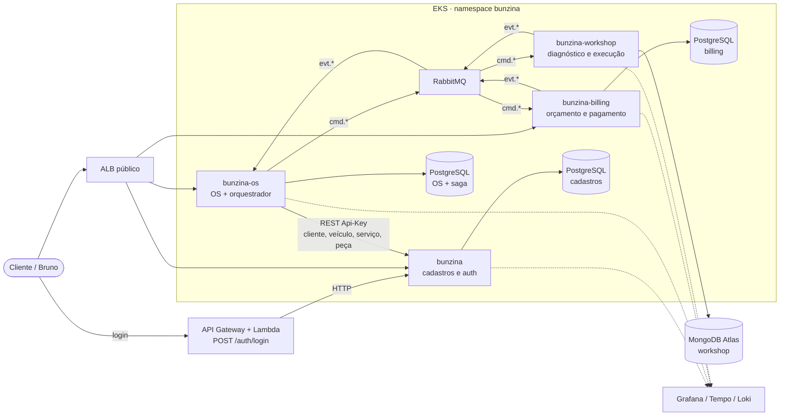

# Arquitetura geral

O `bunzina-os` é o orquestrador. Este diagrama é a visão da solução completa:
quatro serviços, cada um com banco próprio, e RabbitMQ como único broker.
Nenhum serviço acessa o banco de outro.

O workshop **não tem Ingress/ALB**. Na demonstração:
`kubectl port-forward -n bunzina svc/bunzina-workshop 3002:80`.

## Comunicação

| De | Para | Como | Quando |
| --- | --- | --- | --- |
| Cliente | `bunzina` | HTTP no ALB (JWT ou `Api-Key`) | Cadastros e login |
| Cliente | `bunzina-os` | HTTP no ALB | CRUD da OS e entrega |
| Cliente | `bunzina-billing` | HTTP no ALB | Consultar/aprovar orçamento, webhook MP |
| Mecânico | `bunzina-workshop` | HTTP ClusterIP | Diagnóstico e execução |
| `bunzina-os` | `bunzina` | HTTP síncrono + `Api-Key` | Validar cliente/veículo/serviço/peça na criação da OS |
| `bunzina-os` | Billing / Workshop | RabbitMQ, `cmd.*` | Cada passo da saga |
| Billing / Workshop | `bunzina-os` | RabbitMQ, `evt.*` | Resultado de cada passo |

Só este serviço publica comandos. Participantes só publicam eventos. O
`serviceOrderId` é o `correlationId` de todas as mensagens.

Justificativa da saga: [README](../README.md#por-que-saga-orquestrada).
Sequências: [saga-orchestration.md](./saga-orchestration.md).
Bancos: [database.md](./database.md).
