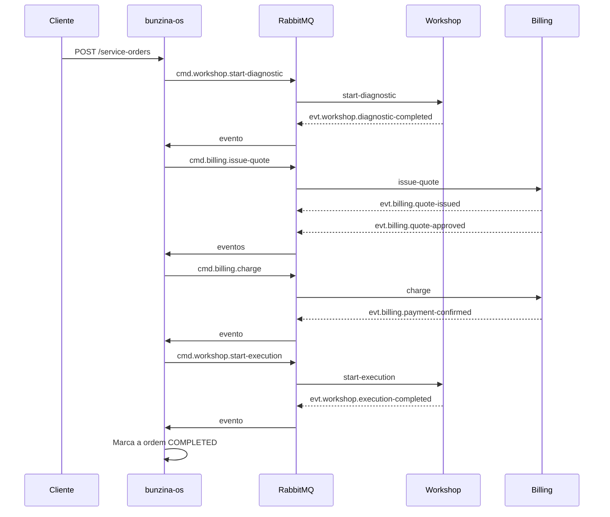
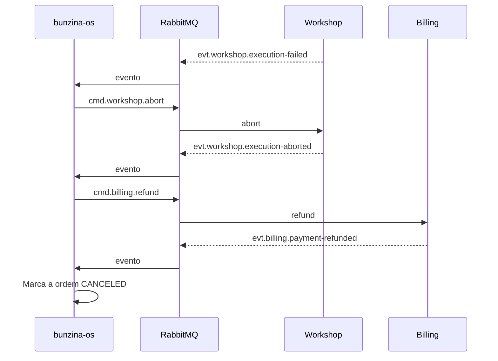

# Saga de ordem de serviço

O `bunzina-os` é o orquestrador. `serviceOrderId` permanece como identificador da
ordem e `correlationId` em todos os envelopes.

## Caminho feliz

## Compensação após falha de execução

Rejeitar um orçamento é um desfecho de negócio. `evt.billing.quote-rejected` retorna a
ordem para `RECEIVED` sem disparar uma compensação.

Os testes em `src/application/saga/saga-orchestrator.bdd.test.ts` percorrem esses
eventos com repositórios em memória. Eles validam o comportamento do `bunzina-os` sem
depender de Billing ou Workshop em execução.
